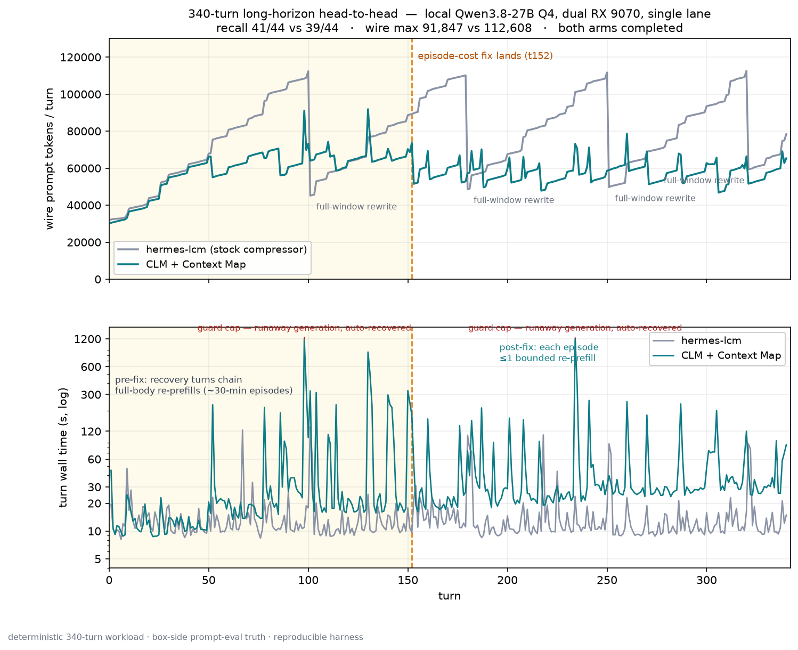

# Hermes CLM + Context Map

**Model-directed, reversible context management for [Hermes Agent](https://hermes-agent.nousresearch.com)** — a context engine that keeps a small active working set, maintains a retained-source **Context Map** the model can look up and restore from, and runs entirely locally.

Inspired by Meta's **Context Language Models** paper — [**arXiv:2609.37725**](https://arxiv.org/abs/2609.37725) (Shao et al., 2026; University of Washington + **Meta Superintelligence Labs** + MIT; [official code](https://github.com/facebookresearch/context-language-models)) — models that manage their own context. This repo is an independent implementation of that idea for Hermes Agent.

> **Status: experimental.** This repo is a curated public snapshot of a working system, validated by a completed 340-turn live head-to-head against the stock Hermes compressor (hermes-lcm). Both arms ran 340/340 turns on the same rig through the same deterministic workload. It is **not** a drop-in production default. Read the [full benchmark report](benchmarks/reports/2026-10-14-long-horizon-breakdown.md) before believing anything here.



---

## What it does

Hermes owns the canonical conversation — append-only, never rewritten. CLM owns only the *effective working context* each inference call sees. The model operates on that layer through `clm_*` tools:

- **`clm_compact`** — replace a span with a summary the model writes itself (directive requires exact key=value facts and identifiers be preserved)
- **`clm_archive`** — move filler out of the active set, reversibly
- **`clm_lookup`** — navigate the Context Map and resolve entries to validated source references
- **`clm_restore`** — bring exact bytes back into the working set (budget-checked; reports `tokens_required` when it can't fit)
- **`clm_replace_summary`**, **`clm_status`** — refine and inspect

The host validates every proposal: protected content, unknown IDs, and budget violations are refused with structured errors; every mutation is transactional (snapshot / rollback). A deterministic fail-closed fallback exists for host-side pressure, and host-armed, model-executed *recovery turns* bound the working set when it exceeds target.

## Context Map

The retained-source layer. Everything that leaves the active set can carry a bounded **semantic index entry**: `clm_compact` / `clm_archive` accept optional `map_path` + description + keywords, which the *model* authors — the *host* owns all operational IDs, provenance, and transaction boundaries.

```
bounded metadata → lookup → validated reference → restore
```

- Hard bounds on labels (96-char titles, 256-char descriptions, 16 keywords) keep the map small.
- Label text is untrusted data: reads return detached metadata, never execute retained tools, and grant no permissions.
- The map is **disabled by default** (`clm.context_map_enabled`); the benchmark arm ran with it enabled.
- Node/reference IDs are host-allocated; semantic placement shares the source operation's transaction, so the map can never point at bytes that weren't actually retained.

## The benchmark

A deterministic 340-turn agent workload (notes, raw dumps, mega-dumps, and 44 delayed-recall probes asked 34 turns after planting; seed 14) was run as one live Hermes session per arm on a single local Qwen3.8-27B Q4 lane:

| | hermes-lcm (stock) | CLM + Context Map |
|---|---:|---:|
| Turns / errors | 340 / 0 | 340 / 2¹ |
| Probe recall | 39/44 | **41/44** |
| Wire max (in-tokens) | 112,608 | **91,847** |
| Wall / turn (mean) | **15.3 s** | 54.3 s (post-fix stretch: 50.9 s) |
| Prefill / turn (mean) | **3,986 ms** | 11,013 ms |
| Decode | 30.7 t/s | 32.8 t/s |
| Cache reuse (sum) | **0.9887** | 0.873 |

¹ Both CLM errors are 20-minute cap kills from unbounded model runaway generations; both were absorbed unattended and the arm still finished. See report §5/§7.

**What the run actually shows:**

- LCM loses recall *at rewrites*: all 5 of its probe misses crossed a compaction (5/13 crossing probes lost; 0/31 non-crossing). CLM rewrites ~5× more often — in small bounded spans — and lost fewer probes (3/43 crossing windows, 1 of which was a timeout casualty).
- The first CLM attempt exposed the real cost bug: recovery episodes chained **full-body re-prefills** (nearly every follow-up call re-processed 70–92k tokens; worst episodes ≈ 30 minutes). Freezing the recovery turn's rendered presentation so follow-ups stay tail-deltas cut each episode to **≤1 bounded re-prefill** — validated across the last 178 turns. That fix is what this repo ships; the design + forensics are in [`docs/recovery-episode-cost-fix.md`](docs/recovery-episode-cost-fix.md).
- Cost is the honest trade: CLM spent ~2.8× the prefill time and ~3.3–3.5× the wall of LCM. Levers in progress: episode summary-length caps and request `max_tokens` plumbing.

Everything — compaction, recovery, lookup, restore — runs on-box. No cloud passes.

## Repo layout

| Path | Contents |
|---|---|
| `hermes_clm/` | The engine: store, budget, policies, selector, recovery turns, exact-budget mixin, Context Map (`retrieval/`), model-facing tools (`tools/`) |
| `plugin/` | The thin Hermes plugin shim (registers the engine; ships the `/clm` command) |
| `tests/` | Curated test suite: store invariants, compaction atomicity, recovery turns, Context Map lookup/restore, retrofit |
| `benchmarks/` | The long-horizon live harness (`live_long_horizon.py`), an offline runner, scenarios, the [report](benchmarks/reports/2026-10-14-long-horizon-breakdown.md), and the chart |
| `data/` | Raw per-turn results for both arms, the deterministic workload, and the box-side server logs |
| `docs/` | Architecture, Context Map, policy, exact-budget, install/config (`engine-readme.md`), troubleshooting, and the [recovery-episode cost fix record](docs/recovery-episode-cost-fix.md) |

## Reproduce

```bash
python -m venv .venv && .venv/bin/pip install -e '.[dev]'
.venv/bin/python -m pytest tests -q               # engine mechanics + host-integration cases

# offline, no model calls:
.venv/bin/python -m benchmarks.runner --scenario benchmarks/scenarios/long_debug_session.json

# live long-horizon arm (needs a local OpenAI-compatible endpoint; see the harness docstring):
.venv/bin/python -m benchmarks.live_long_horizon gen    --seed 14 --turns 340 --out ~/lh-bench
.venv/bin/python -m benchmarks.live_long_horizon run    --arm lcm --state ~/lh-bench --count 340
.venv/bin/python -m benchmarks.live_long_horizon run    --arm clm --state ~/lh-bench --count 340
.venv/bin/python -m benchmarks.live_long_horizon report --state ~/lh-bench
```

The harness talks to any OpenAI-compatible llama.cpp-style endpoint (`CLM_BENCH_BASE_URL`); box-log attribution is optional — without a server log to pull it degrades to provider-side metrics. Some tests exercise Hermes host-integration paths and **skip automatically** unless a compatible Hermes checkout is importable (set `HERMES_AGENT_PATH` to point at one).

## Limitations & honesty section

- **n=1 per arm, one machine.** A single-run comparison on one rig, not a controlled study.
- **The workload and harness are self-authored and deterministic** (seed 14; byte-identical inputs for both arms). It exercises one long-horizon shape: accumulating notes, dumps, and delayed-recall probes.
- **The CLM full-run means include its pre-fix era** (t1–151); the fix landed mid-run and was validated on the remaining 178 turns (50.9 s/turn). A clean full-arm rerun post-fix hasn't been done yet.
- **Two runaway generations** (~2 per 250 turns) hit the harness's 20-min per-turn cap; the root cause is `max_tokens` not being plumbed on this path. The harness cap plus server cancel-on-disconnect absorbed both.
- **Context Map recall is exercised via the engine's own probes**, not an isolated map-only ablation.
- **Production soak:** one live bot ran on this engine during development; it is not flipped on as anyone's default.
- Nothing here should be read as "beats the stock compressor at everything." It trades cost for recall fidelity, with the cost gap closing.

## Install (plugin)

See [`plugin/README.md`](plugin/README.md) and [`docs/engine-readme.md`](docs/engine-readme.md). Short version: `pip install -e .`, copy `plugin/` into `$HERMES_HOME/plugins/hermes-clm/`, and set `context.engine: hermes-clm` in the profile config.

**Host compatibility note:** during development this engine carried two small host-side fixes (a tool re-injection normalization so `clm_*` tools survive mid-run tool rebuilds, and a detached-fork adoption fix) applied to a local Hermes checkout. They are not included here — on a stock host, verify `clm_*` tool delivery after a session's mid-run tool rebuild (see [`docs/troubleshooting.md`](docs/troubleshooting.md)).

## License & provenance

MIT. An **independent implementation inspired by [Context Language Models](https://arxiv.org/abs/2609.37725)** — Shao et al., 2026 ([official code](https://github.com/facebookresearch/context-language-models)) — no reference code is bundled. Everything in this repo was built and run locally.
